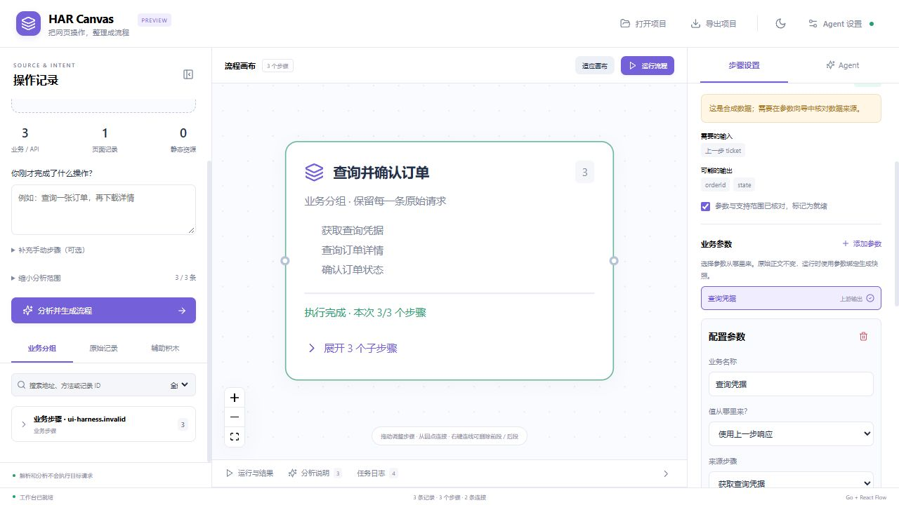

# HAR Canvas

把 HAR 请求记录整理成可拖动、可编辑、可调试的流程。Agent 解释请求、归纳业务步骤并自动生成可编辑的画布；用户检查参数、调整连接并决定何时执行。

## 当前原型

- 首次打开和刷新都保持空白，不加载测试包、上次 HAR 或历史项目。只有用户主动选择或拖入 HAR 才解析。主题与明确保存的模型设置可以保留。
- 默认白色主题，支持切换和记住深色偏好。导入后可描述操作目标，按页面、时间、域名、资源类型和关键词筛选。
- 默认「主流程分析」先将当前范围的紧凑请求目录交给 Agent，挑出关键请求，再详细解读选中项；目录筛选本身不创建方块，未选项仍为待分析，可能需要补充遗漏步骤。可切换「全部逐条分析」，或点击待分析记录单独补充。同一会话中已有有效说明的请求不会重复调用模型。
- 模型为详细分析的请求生成名称和用途说明。只有对应原 HAR、且名称和用途均非空的分析结果才会成为可用的请求方块；未分析、名称或说明不完整的请求不会补成占位方块；用途不确定时由 Agent 明确说明分析边界。
- 通过校验的分析结果分批自动加入画布，按业务分组折叠展示，展开可查看原始子请求。有证据的字段关系自动连线，并为支持的字段预填上游参数绑定；推测关系或不支持的编码保留在待确认清单。用户改名、拖动或删除后不会被后续结果静默覆盖。
- 辅助积木包括输入参数、字段提取、条件判断、人工输入、结果断言和输出。参数向导支持固定值、用户填写、前序输出、运行时生成与人工输入；响应字段可用树形选择器选择。
- 配置用户自己的兼容 Chat Completions 的 API：地址以 `/v1` 结尾，调用 `/chat/completions`。
- 地址、模型和 API Key 使用明文输入。只有点击保存才保存到当前浏览器；可明确清除。项目导出不包含模型凭据。
- 导入、分析与自动生成不会执行请求，模型只能提供结构化解释，不能运行任意代码或命令。
- 分析使用后台任务与短轮询，避免网关长连接超时。详细解读首批最多 4 条、后续最多 12 条及约 96 KiB 顺序分批，支持停止和保留完成结果，不自动重试模型调用。正文使用前 4096 字节预览；跨批次共享全局目录、字段关系和已识别步骤。日志包含真实模型阶段、大小、耗时与关联编号，可导出，不记录 Key、Cookie 或 HAR 正文。主流程目录最多 1000 条、512 KiB，选中项最多 24 条；超限会明确提示缩小范围，不会静默忽略记录。
- 运行前预检定位具体节点与字段，选择入口后只执行可达流程，并使用不可变快照。真实服务器事件驱动绿色运行动画、计时、失败及跳过状态；断线后可继续观察同一任务，人工输入在原会话中暂停与继续。支持 `{{name}}` 与 `{{nodeId.body.field}}`。
- HTTP 4xx/5xx 默认失败，可配置接受范围；业务成功使用独立断言判断。画布最多 3000 节点和 5000 连接，一次执行最多 100 个可达节点、300 条连接。任务限时 10 分钟（含人工暂停），完成结果保留 15 分钟。
- 导入、导出画布项目 JSON。
- 右键连线可以删除连线、删除前段或删除后段；菜单显示影响数量，工具栏支持撤销删除。前段包含连线起点及全部上游，保留终点；后段包含终点及全部下游，保留起点。共享节点的关联线也会移除。
- 每个积木右上角的垃圾桶可直接删除该积木，同时移除它的关联连线；工具栏的「撤销删除」可以恢复。也支持选中后按 Delete，或使用属性面板中的删除按钮。

空白页提供主动打开的无网络练习：输入参数 → 人工暂停 → 业务断言 → 输出结果。无需 HAR 或模型 API，可以体验正确输入与失败定位。已有项目通过“打开项目”主动恢复；`examples/condition-demo.json` 也可以导入。



## 本地运行

需要 Go 1.26+ 和 Node.js 24+。

```powershell
cd web
npm install
npm run build
cd ..
go run ./cmd/server -addr 127.0.0.1:8090 -web web/dist
```

打开 `http://127.0.0.1:8090`。

仓库不附带真实 HAR，原始抓包文件不会进入 Git 或 Docker 构建。后端保留显式读取本地样例的兼容接口与 `-sample-har "完整路径"` 参数，前端初始化不调用它。

浏览器文件上传最多 256 MiB、10000 条原始记录。请求头与请求体保持完整；参考响应提供前 16 KiB 预览，完整响应通过随机导入编号按需读取，在服务器内存保留 30 分钟。最多保留三份导入，受总量限制时释放较旧记录；过期后重新导入即可。上传不写入服务器磁盘。非 HTTP 记录会跳过并显示提示。

开发前端时在另一个终端运行 `cd web; npm run dev`，Vite 会把 `/api` 转发到后端的 8090 端口。

## Docker

```sh
docker build -t har-canvas .
docker run --rm -p 127.0.0.1:8090:8090 har-canvas
```

可通过环境变量启用内置 HTTP BasicAuth。`HAR_CANVAS_USER` 和 `HAR_CANVAS_PASSWORD` 必须同时配置，只配置其中一个会启动失败；两者均未配置时维持本地无认证模式。认证覆盖网页、静态资源、健康检查、API 和默认 HAR 样例，浏览器首次访问时会提示输入账号密码。

```powershell
$env:HAR_CANVAS_USER = "your-user"
$env:HAR_CANVAS_PASSWORD = "your-password"
go run ./cmd/server -require-auth -addr 127.0.0.1:8090 -web web/dist
```

公网服务应启用 `-require-auth`：当任一凭据为空或环境文件未提供有效值时，服务直接拒绝启动，避免误以无认证模式运行。本地不传该标志时仍保留上述可选认证行为。

Docker 可使用 `--env-file` 提供这两个变量。对外发布时使用平台提供的 HTTPS 入口，或由 HTTPS 终止服务转发到应用端口；BasicAuth 不加密 HTTP 连接中的凭据，不应通过公网明文 HTTP 使用。后端端口应只允许可信入口访问。

当前版本按单用户工作台设计，可以发出网络请求、显示 HAR 和模型凭据。上传 HAR 不会自动触发请求，也不会写入服务器磁盘；模型分析仅在点击分析时发出，所选请求会发送到用户配置的模型服务。

Instabox 的持久目录、systemd 安装与端口发布步骤见 [部署说明](deploy/README.md)。公网验收可设置 `HAR_CANVAS_URL` 后运行 `node scripts/verify-deployment.mjs`；认证读取忽略的 `.deployment/service.env`，可用 `HAR_CANVAS_ENV_FILE` 指定其他文件。额外设置 `HAR_CANVAS_VERIFY_EXAMPLE=1` 可验证默认测试包和完整响应读取，不会回放抓包请求。

## 运行约束

- HAR 是一次网络观察记录，不保证包含动态签名、Token 生成、页面脚本等全部逻辑。
- 这里运行的是 HTTP 流程，不是浏览器点击和页面自动化。验证码、人工交互、浏览器状态仍需要额外处理。
- 运行器阻止访问服务器内网、回环和链路本地地址，检查 DNS、重定向，并限制请求时间和响应大小。
- 模型输出只作为结构化建议处理，不能运行任意代码或命令。
- Cookie 和 Token 可能过期。实际发起请求前应检查目标、参数和凭据。
- 第一版提供流程项目导出；还没有独立 Go/JS 程序导出。
- 条件的 `exists` 表示变量存在且不是 `null`，空字符串也算存在。多条分支汇合时，任一有效分支可达就会执行汇合节点；运行器会先等待所有前驱处理完毕。图中的循环暂不支持。

## 验证

```sh
go test ./...
cd web
npm run build
npm run test:graph
npm run test:agent
npm run test:blocks
```

启动后端后，还可以在项目根目录运行 `node scripts/smoke.mjs`。它通过本地模拟模型接口验证 `/v1/chat/completions`，不需要真实 Key，也不访问外部目标。

新增 `npm test` 运行全部前端单元测试。`node scripts/smoke-runtime.mjs` 自行启动隔离模拟服务，实际等待超过 20 秒的模型响应，并覆盖分析不重放、人工暂停、断言、HTTP 失败、增量事件和结构化预检，不需要真实 Key。真实 HAR 验收只进行导入与授权的模型分析，不执行抓包中的注册请求。当前 Windows 环境未运行 race 检测，Docker 镜像未实测。

完整设计见 [产品规划](docs/product-plan.md)，接口见 [API_CONTRACT.md](API_CONTRACT.md)，本轮检查记录见 [实施审计](docs/implementation-audit.md)。
