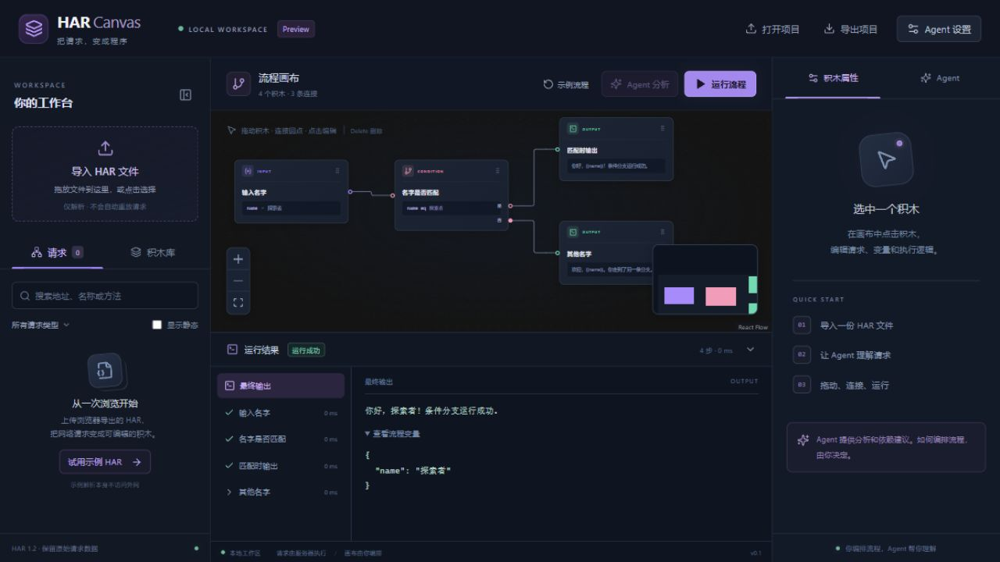

# HAR Canvas

把 HAR 请求记录整理成可拖动、可编辑、可调试的流程。Agent 负责解释请求和提出依赖建议；用户决定哪些方块放进画布、如何连接、何时执行。

## 当前原型

- 浏览器上传 HAR，按域名、资源类型和关键词浏览请求。
- 拖动请求到画布，组合输入、HTTP 请求、字段提取、条件判断、输出方块。
- 配置用户自己的兼容 Chat Completions 的 API：地址以 `/v1` 结尾，调用 `/chat/completions`。
- 地址、模型和 API Key 使用明文输入。只有点击保存才保存到当前浏览器；可明确清除。项目导出不包含模型凭据。
- Agent 返回请求名称、解释、依赖和变量建议，不会自行执行请求或替用户连接业务流程。
- 当前筛选列表可一次提交分析，自动按最多 50 条和约 96 KiB 分成顺序批次，显示进度并支持停止；某批失败时保留前面完成的结果，不自动重试模型调用。正文使用前 12000 字节预览，原始 HAR 保持完整。各批独立分析，跨批次依赖需人工核对。
- 手动执行流程，查看每个节点状态和响应。支持 `{{name}}` 变量和 `{{nodeId.body.field}}` 响应引用。
- 导入、导出画布项目 JSON。
- 右键连线可以删除连线、删除前段或删除后段；菜单显示影响数量，工具栏支持撤销删除。前段包含连线起点及全部上游，保留终点；后段包含终点及全部下游，保留起点。共享节点的关联线也会移除。

初次打开就有一个不访问网络的「输入 → 输出」示例，直接点击右上角运行即可。`examples/condition-demo.json` 可以通过「打开项目」载入，体验条件判断和跳过分支。



## 本地运行

需要 Go 1.26+ 和 Node.js 22+。

```powershell
cd web
npm install
npm run build
cd ..
go run ./cmd/server -addr 127.0.0.1:8090 -web web/dist
```

打开 `http://127.0.0.1:8090`。

可选默认测试包：将 HAR 放在 `samples/re.har`，打开页面时会自动解析，不会自动调用 Agent 或重放。仓库不附带真实 HAR，原始抓包文件也不会进入 Git 或 Docker 构建。可通过 `-sample-har "完整路径"` 指定其他文件，服务重启后生效；没有该文件时仍能手动导入或试用公开 API 小示例。

大包由后端直接读取，最大 256 MiB。请求头与请求体保持完整；参考响应先提供前 64 KiB 预览，并标记截断。把请求加入画布后，在积木属性的「HAR 参考响应」里可以按需读取完整响应。普通浏览器上传仍限 32 MiB。非 HTTP 记录会跳过并显示提示。

开发前端时在另一个终端运行 `cd web; npm run dev`，Vite 会把 `/api` 转发到后端的 8090 端口。

## Docker

```sh
docker build -t har-canvas .
docker run --rm -p 127.0.0.1:8090:8090 har-canvas
```

可通过环境变量启用内置 HTTP BasicAuth。`HAR_CANVAS_USER` 和 `HAR_CANVAS_PASSWORD` 必须同时配置，只配置其中一个会启动失败；两者均未配置时维持本地无认证模式。认证覆盖网页、静态资源、健康检查、API 和默认 HAR 样例，浏览器首次访问时会提示输入账号密码。

```powershell
$env:HAR_CANVAS_USER = "your-user"
$env:HAR_CANVAS_PASSWORD = "your-password"
go run ./cmd/server -require-auth -addr 127.0.0.1:8090 -web web/dist
```

公网服务应启用 `-require-auth`：当任一凭据为空或环境文件未提供有效值时，服务直接拒绝启动，避免误以无认证模式运行。本地不传该标志时仍保留上述可选认证行为。

Docker 可使用 `--env-file` 提供这两个变量。对外发布时使用平台提供的 HTTPS 入口，或由 HTTPS 终止服务转发到应用端口；BasicAuth 不加密 HTTP 连接中的凭据，不应通过公网明文 HTTP 使用。后端端口应只允许可信入口访问。

当前版本按单用户工作台设计，可以发出网络请求、显示 HAR 和模型凭据。上传 HAR 不会自动触发请求，也不会写入服务器磁盘；模型分析仅在点击分析时发出，所选请求会发送到用户配置的模型服务。

Instabox 的持久目录、systemd 安装与端口发布步骤见 [部署说明](deploy/README.md)。公网验收可设置 `HAR_CANVAS_URL` 后运行 `node scripts/verify-deployment.mjs`；认证读取忽略的 `.deployment/service.env`，可用 `HAR_CANVAS_ENV_FILE` 指定其他文件。额外设置 `HAR_CANVAS_VERIFY_EXAMPLE=1` 可验证默认测试包和完整响应读取，不会回放抓包请求。

## 运行约束

- HAR 是一次网络观察记录，不保证包含动态签名、Token 生成、页面脚本等全部逻辑。
- 这里运行的是 HTTP 流程，不是浏览器点击和页面自动化。验证码、人工交互、浏览器状态仍需要额外处理。
- 运行器阻止访问服务器内网、回环和链路本地地址，检查 DNS、重定向，并限制请求时间和响应大小。
- 模型输出只作为结构化建议处理，不能运行任意代码或命令。
- Cookie 和 Token 可能过期。实际发起请求前应检查目标、参数和凭据。
- 第一版提供流程项目导出；还没有独立 Go/JS 程序导出。
- 条件的 `exists` 表示变量存在且不是 `null`，空字符串也算存在。多条分支汇合时，任一有效分支可达就会执行汇合节点；运行器会先等待所有前驱处理完毕。图中的循环暂不支持。

## 验证

```sh
go test ./...
cd web
npm run build
npm run test:graph
npm run test:agent
```

启动后端后，还可以在项目根目录运行 `node scripts/smoke.mjs`。它通过本地模拟模型接口验证 `/v1/chat/completions`，不需要真实 Key，也不访问外部目标。

前端构建、Go 单元测试、`go vet` 和接口冒烟检查已通过。当前 Windows 环境未启用 CGO，因此没有运行 race 检测；真实模型提供商和 Docker 镜像尚未实测。

接口约定见 `API_CONTRACT.md`。
